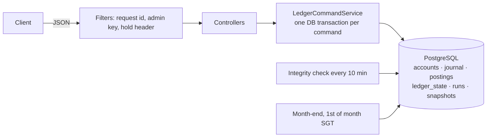
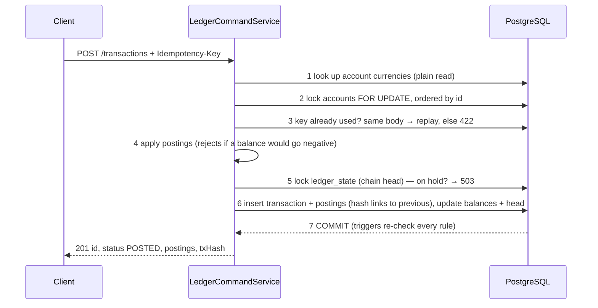
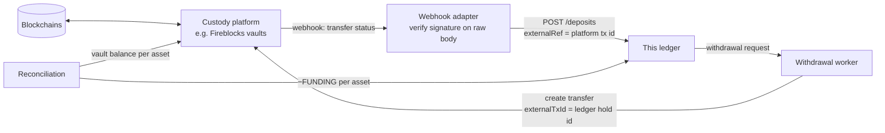

# Design decisions — Internal Ledger

 Status: written before implementation; the **Evidence** line of each decision is filled in as the phase that builds it lands (`PLAN.md` §11).

---

## 1. Context and goals

Base Requirements: 
- a ledger that records transfers atomically, 
- answers balance and history queries, 
- behaves correctly under retries, concurrency, reversals, multiple currencies and month-end reconciliation.

I built it as the kind of internal ledger a digital-asset custodian keeps beside its custody platform. The platform (for example Fireblocks) holds the keys and moves assets on-chain; the ledger is the book of record for **who owns how much**. That framing shaped three choices: every outside movement can carry the platform's id and is booked at most once (ADR-07), the ledger can prove its totals at any moment (ADR-11), and history is tamper-evident (ADR-10). How the two systems connect is designed in ADR-15; the integration itself is out of scope.

---

## 2. Assumptions

| # | Assumption | If this is wrong |
|---|---|---|
| A1 | An account holds one currency. A customer with SGD and USD has two accounts. | Postings already carry a currency; balances would need one per currency |
| A2 | "Cents" means each currency's smallest unit (ISO 4217): SGD/USD/EUR 2 decimals, JPY 0. The API takes and returns integers in that unit. | A decimal-string API is a thin parsing layer on top |
| A3 | Customer wallets and the house's FX wallets can never go negative. | Overdrafts would replace the zero floor with a per-account limit |
| A4 | Money enters and leaves only through deposits and withdrawals, recorded against one FUNDING account per currency that stands for the outside world (its balance is minus the net money deposited). | — |
| A5 | A deposit or withdrawal may carry the outside system's id for it (`externalRef`), and that id is unique for the life of the ledger. | Ids that repeat across systems would be scoped by source (`fireblocks:…`, `bank:…`) |
| A6 | The server assigns every timestamp from the database clock; clients can't backdate. History is returned oldest first, in posting order. | Backdating would need an `effective_at` column and period locks |
| A7 | Cross-currency transfers use the newest stored rate for the pair, rounded down. Demo rates are seeded; an admin can add rates. The house's FX wallets can run out. | Live market rates replace the rate source, not the posting model |
| A8 | Reversals are full, at the original amounts and rate, happen at most once, can't themselves be reversed, and fail if the money has since been spent. | Partial reversals need a cap on the cumulative reversed amount |
| A9 | Idempotency keys are generated by the client, unique for the life of the ledger, and required on every money-moving request. | Several clients would scope keys per client |
| A10 | Month-end follows calendar months in `Asia/Singapore`; data is stored in UTC. Reconciling a month that hasn't ended gives a provisional report. | The zone is one config value |
| A11 | When a check finds a discrepancy, the ledger stops moving money until an operator releases it. | Report-only mode is one line in `IntegrityService` |
| A12 | This is an internal service behind a gateway: normal endpoints are unauthenticated; admin endpoints need a key. | Add Spring Security with real identities |
| A13 | One running instance was tested. The design is safe for several (all coordination is database locks) but untested at scale. | See §6 |

---

## 3. Architecture at a glance

One transfer:

---

## 4. Decisions

Each decision: context → options → decision → consequences, then **In plain words** and **Evidence** (the tests that prove it).

### ADR-01 Double-entry journal

- **Context:** a balance column plus a list of transfers can't prove where money came from; a bug can create or destroy money silently.
- **Options:** (a) balance column + transaction log; (b) double-entry: every transaction is ≥ 2 postings whose debits equal credits per currency.
- **Decision:** (b). Transfers have 2 postings, FX transfers 4, reversals mirror the original. Each account caches its balance and a version counter; the postings are the source of truth.
- **Consequences:** every balance can be recomputed from postings, and "no money created or lost" becomes a query. A few more rows per transfer.
- **In plain words:** every movement is written as where the money left and where it arrived, for the same amount. The books always sum to zero; if they don't, the check names the transaction that broke them.
- **Evidence:** `TransferApiIT` (2 balanced postings per transfer), `SchemaGuardrailsIT`, `IntegrityIT` (trial balance and transaction balance clean after a mixed workload), `ConcurrencyIT`.

### ADR-02 One balance rule for every account

- **Context:** classic accounting has debit-normal and credit-normal accounts, which is easy to get backwards.
- **Decision:** every account follows **credit = money in, debit = money out**, `balance = credits − debits`. Three kinds: CUSTOMER wallets and the house's FX_LIQUIDITY wallets (never below 0), and one FUNDING account per currency that stands for the outside world (never above 0). A deposit debits FUNDING and credits the wallet.
- **Consequences:** each currency's balances sum to exactly zero, and "money in wallets = −FUNDING balance" is the money-supply check. A general ledger would show FUNDING as a positive asset; that is only presentation. In a custody setup, −FUNDING per asset is the figure that must match the custody vault's balance (ADR-15).
- **In plain words:** every account is read from its own point of view: credit is money in, debit is money out. The funding account is the outside world, so it goes negative by exactly the amount deposited — which is why everything sums to zero.
- **Evidence:** `DepositWithdrawalApiIT` (deposit debits FUNDING, withdrawal credits it), `IntegrityIT` (`MONEY_SUPPLY` matches in all 4 currencies).

### ADR-03 Integer minor units

- **Context:** floating point can't represent 0.10 exactly.
- **Decision:** `long` minor units in Java, `bigint` in Postgres, decimals per currency from ISO 4217. `BigDecimal` only inside FX maths, converted back with an explicit rounding mode. Additions use `Math.addExact`. The API rejects `10.5` and `"100"`.
- **Consequences:** exact arithmetic and simple comparisons. `bigint` holds about 9.2 × 10^18 minor units — enough for fiat, BTC (8 decimals) and USDC (6), not for 18-decimal tokens (§7).
- **In plain words:** amounts are whole numbers of cents, so 0.1 + 0.2 is exactly 30 cents. Decimals appear only when converting currencies, and there I round down on purpose.
- **Evidence:** `MoneyTest`, `AccountTest` (overflow throws), `JacksonConfigIT`, `TransferApiIT` (`10.5` and `"100"` → 400), `FxConversionTest`.

### ADR-04 Rules enforced in PostgreSQL, not only in Java

- **Context:** application code has bugs; a ledger should refuse bad writes anyway.
- **Decision:** Java gives friendly errors; the database is the last line of defence. It refuses: unbalanced transactions, fewer than 2 postings, negative customer balances, a posting in the wrong currency, any UPDATE or DELETE of history, an account created with money in it, a balance change without a matching posting, a reversal that doesn't mirror its original, a reused external reference, a transaction that doesn't link to the previous hash, and a month-end snapshot from a run that wasn't clean.
- **Consequences:** a whole class of bugs can't be saved. A guardrail firing means a bug → 500 `INVARIANT_VIOLATION`.
- **In plain words:** even with a bug in the Java code, Postgres would refuse to save an unbalanced transaction, a negative balance or an edited history row. Every rule was tested on a real database before the service was written.
- **Evidence:** `SchemaGuardrailsIT` (35 cases, plus a valid transfer still committing afterwards).

### ADR-05 Concurrency: row locks in a fixed order, chain head last

- **Context:** two transfers that read the same balance and both write it back lose one update.
- **Options:** (a) optimistic `@Version` + retry; (b) SERIALIZABLE + retry; (c) `SELECT … FOR UPDATE` in a fixed order; (d) a single-writer queue per account.
- **Decision:** (c), under READ COMMITTED, one database transaction per command. All accounts are locked in one query ordered by id; the single `ledger_state` row is locked last. Lock waits time out after 3 s → 503 `TRY_AGAIN`; there is no retry loop in the server — the client retries with the same idempotency key, which is safe.
- **Consequences:** writers on the same account queue instead of failing; opposite transfers can't deadlock because every transaction takes locks in the same order. Because every write also passes the chain head, writes commit one at a time — a throughput ceiling (about 200 writes per second in a local simulation), fine here; ADR-10 says how I'd lift it. A queue (d) would serialise too, but the client would no longer get a definite answer in the same request.
- **In plain words:** before touching balances, a transfer locks the accounts it uses, always lowest id first. A second transfer on the same account waits its turn, so no update is lost, and two transfers in opposite directions can't block each other forever.
- **Evidence:** `ConcurrencyIT` (1 000 transfers against a balance that covers 500 → exactly 500 succeed, balance 0; 500 opposite-direction transfers all succeed; integrity clean afterwards), `RandomizedInvariantIT` (3 seeds × 150 operations, every outcome and balance predicted by an in-memory model).

### ADR-06 Idempotency: the key lives on the transaction row

- **Context:** a client that times out retries; it must not move money twice.
- **Options:** (a) a separate idempotency table caching responses for a time window; (b) the key + a fingerprint of the request stored on the journal transaction under a permanent UNIQUE constraint; (c) guessing duplicates from the content.
- **Decision:** (b), with the status codes of the IETF `Idempotency-Key` draft: missing → 400; same key + same body → the original (201, `Idempotent-Replayed: true`); same key + different body → 422. The check runs **after** the account locks, so a duplicate in flight waits for the first and then replays it. Funds, external-reference and "already reversed" checks run after the key, so a retry of something that succeeded is replayed, not re-judged.
- **Consequences:** nothing expires, so an old key can never move money again; replays are rebuilt from the stored transaction, so they're identical. A request rejected for a business reason (e.g. insufficient funds) wrote nothing, so the same key can be retried later. For comparison, Fireblocks' own API keeps idempotency responses for 24 hours and replays the first response even when it was an error ([docs](https://developers.fireblocks.com/reference/api-idempotency)) — a cache (a). For money that can't move twice I prefer a permanent key, and I let rejected requests be retried because nothing happened.
- **In plain words:** the client sends a unique key with each transfer. It is saved on the transaction itself under a unique constraint, so a retry finds the original and gets it back instead of moving money again — and two identical requests at the same instant queue on the same row locks, so only one ever runs.
- **Evidence:** `IdempotencyApiIT` (identical replay with `Idempotent-Replayed`; different body → 422; a successful transfer still replays after the money was spent), `IdempotencyRaceIT` (20 simultaneous duplicates → 1 transaction), `DepositWithdrawalApiIT`, `IdempotencyKeysTest`, `RequestFingerprintTest`, `GlobalExceptionHandlerTest` (key race on the unique constraint → 422).

### ADR-07 External references: one outside movement, booked once

- **Context:** idempotency keys protect against a *client* retrying. A custodian has a second risk: the *same outside event* arriving twice through different paths — a webhook delivered again, a reconciliation job and an operator both booking it, two services each creating their own key. Fireblocks, for example, retries webhooks it thinks failed and asks API callers to set a unique `externalTxId` for the same reason ([webhooks](https://developers.fireblocks.com/reference/consume-webhooks), [idempotency](https://developers.fireblocks.com/reference/api-idempotency)).
- **Decision:** deposits and withdrawals accept an optional `externalRef` — the outside system's id for that movement (a Fireblocks transaction id, a bank reference). It is stored on the journal transaction under a UNIQUE constraint, included in the fingerprint and in the hash. A second request with the same reference under a different key → 409 `EXTERNAL_REF_ALREADY_USED`; the same key and body → a normal replay. Only deposits and withdrawals may carry one (a database CHECK).
- **Consequences:** an outside deposit can never be credited twice, whoever books it. Two requests with the same reference in one currency queue on the funding account's lock; in different currencies the unique constraint decides.
- **In plain words:** when money arrives from outside, I record the outside system's own id for it, and the database refuses that id a second time. The idempotency key stops a client repeating itself; the external reference stops the same real-world event being booked twice.
- **Evidence:** `DepositWithdrawalApiIT` (same reference under a new key → 409, credited once), `SchemaGuardrailsIT` (cases 34–35).

### ADR-08 Corrections are reversals, never edits

- **Context:** an auditable ledger never rewrites history.
- **Decision:** a reversal is a new transaction whose postings mirror the original's (debits and credits swapped). At most one per transaction, never of a reversal, and it fails if an account would go negative. The database checks the mirror at commit.
- **Consequences:** history shows both what happened and how it was corrected; the original links to its reversal.
- **In plain words:** a transaction is never edited or deleted. To undo one, its exact opposite is posted. If the money was already spent, the reversal is refused like any other transfer.
- **Evidence:** `ReversalApiIT` (mirror, second reversal → 409, reversal of a reversal → 422, money already spent → 422, retried reversal replays, FX transfer reversed exactly in both currencies).

### ADR-09 FX through house liquidity wallets

- **Context:** a transfer from an SGD account to a USD account can't balance in one currency.
- **Decision:** 4 postings: the sender pays SGD into the house's SGD wallet, and the house pays USD from its USD wallet to the recipient. Each currency balances on its own. The rate is the newest stored row for the pair; its id is saved on the transaction. The converted amount is rounded **down** (the fraction stays with the house, which stops rounding games). Demo rates are seeded (one table of USD values, so all 12 pairs agree); admins add rates via `POST /admin/fx-rates`. The house wallets are funded at startup through normal deposits.
- **Consequences:** FX gains and losses are visible in the house wallets; FX can fail with `INSUFFICIENT_LIQUIDITY`, which is realistic. Live rates would change only where the rate comes from.
- **In plain words:** converting currency is two trades with the house: the customer gives the house SGD, the house gives the recipient USD. Each currency's books balance separately, and the exact rate is stored, so any conversion can be audited later.
- **Evidence:** `FxConversionTest` (all Appendix A vectors, floor rounding), `FxTransferApiIT` (SGD 100.00 → USD 77.50 through both house wallets; admin rate used next; house short → 422; too small → 422), `FxRatesApiIT`, FX case of `ReversalApiIT`, `LedgerApplicationIT` (house wallets funded once).

### ADR-10 A hash-chained journal ("basic blockchain")

- **Context:** constraints stop bad writes through the app; someone with direct database access could still edit history.
- **Options:** (a) nothing; (b) chain every transaction to the previous one, inline; (c) batch transactions into Merkle-tree blocks sealed in the background; (d) write to a real blockchain.
- **Decision:** (b). Each transaction stores `prev_hash` and `tx_hash = SHA-256` over a length-prefixed encoding of its chain index, the previous hash, its fields and its postings. `ledger_state` holds the head; `GET /ledger/head` exposes it so it can be recorded outside the system. A verifier recomputes every hash and link. Not (d): this is one operator's internal book of record — the assets themselves live on-chain in the custody platform (ADR-15); putting the ledger on a chain would add cost, latency and data exposure without adding trust.
- **Consequences:** editing any transaction breaks its hash and every later link, and the verifier names the exact transaction. Deleting the newest one is caught by the head. Cost: every write passes one row, so writes commit one at a time. (b) is fully explainable and testable; (c) is how I'd lift the throughput ceiling.
- **In plain words:** each transaction's fingerprint includes the previous transaction's fingerprint, like blocks in a blockchain. Change one old transaction and its fingerprint stops matching, and so does every link after it. Someone with full database access could recompute everything, which is why the latest fingerprint is published to be kept outside.
- **Evidence:** `TxHasherTest` (vectors agreed by two independent implementations), `TransferApiIT` (hash recomputed from the API response; `prevHash` links to the previous transaction), `IntegrityIT` (whole chain valid, ends at `/ledger/head`), `TamperDetectionIT` (an edited description is caught only by `CHAIN_TX_HASH_MISMATCH`).

### ADR-11 Integrity checks and a fail-closed hold

- **Context:** the brief asks to verify that total money matches the expected sum and to report discrepancies.
- **Decision:** on demand and every 10 minutes, in one consistent database snapshot: trial balance per currency (debits = credits, balances sum to 0), every transaction balanced, every cached balance = its postings, money supply (money in wallets = net money deposited, per currency) and the hash chain. The run and each discrepancy are stored. Any discrepancy turns on the **integrity hold**: writes get 503, reads continue with an `X-Ledger-Integrity: HOLD` header, and an admin releases it with a reason.
- **Consequences:** a custodian never keeps moving money on balances it has proved wrong. The cost is that a checker bug becomes an outage, so the checks are tested against deliberate tampering.
- **In plain words:** the system re-adds everything from scratch and compares it with what it stored. If anything disagrees, it stops moving money until a person looks — a short outage is better than moving money on wrong numbers.
- **Evidence:** `IntegrityIT` (clean run, stored run, hold gives 503 on writes and `X-Ledger-Integrity: HOLD` on reads, admin release), `TamperDetectionIT` (raised posting amount → 4 checks fire, hold on, replays still answer). During design, seven simulated attacks on a real database (edited amount, inflated balance, deleted newest transaction, edited description, edited external reference, edited closed month, edited recorded closing) were each caught.

### ADR-12 Month-end reconciliation with frozen snapshots

- **Context:** at month-end each account must be reconciled against its history.
- **Decision:** for each account: opening = the balance recorded before the month, plus the month's credits minus its debits, must equal the balance recorded at month end. A clean close of a finished month freezes a snapshot per account; next month's opening must equal it, and re-running a closed month must still match it — which catches edits after the close. Months follow Singapore time; data is stored in UTC. A month that hasn't ended gives a provisional report and freezes nothing.
- **In plain words:** for every account, take last month's frozen closing balance, add everything that happened this month, and check it lands exactly on the balance the system recorded. Then freeze it; next month must start from it.
- **Evidence:** `MonthEndIT` (final close freezes one snapshot per account; re-close writes none; unfinished month is provisional; future month → 400), `TamperDetectionIT` (edit inside a closed month → `MONTH_END_CLOSING_MISMATCH`).

### ADR-13 Spring Data JPA, with four rules

- **Context:** JPA is the most familiar Spring persistence style, but it hides SQL that matters in a ledger.
- **Decision:** JPA for entities and commands, with rules: Flyway owns the schema (`ddl-auto=validate`); journal entities are `@Immutable`; accounts and the chain head are locked by explicit `@Lock(PESSIMISTIC_WRITE)` queries and never loaded before that (Hibernate would hand back a stale copy); integrity and month-end queries are plain SQL files.
- **In plain words:** JPA keeps routine code short; the parts that need exact SQL — locking and reconciliation — are explicit, so it is clear what runs. `@Lock(PESSIMISTIC_WRITE)` becomes `SELECT … FOR UPDATE`.
- **Evidence:** `ConcurrencyIT`; `ddl-auto=validate` passing in every integration test.

### ADR-14 API and error model

- **Decision:** paths exactly as in the brief (`POST /transactions`, `GET /accounts/{id}`, `GET /accounts/{id}/transactions`); integer minor units in requests; money objects with a display string in responses; RFC 9457 problem details with a stable `code` field and a hint in `detail`; a request id on every response; Swagger UI at `/`; demo accounts with fixed ids so a reviewer can try it immediately.
- **In plain words:** clients branch on a stable error code, not on message text, and every response carries a request id that can be found in the logs.
- **Evidence:** `AccountApiIT` (problem+json, `code`, `requestId`, validation errors), `ErrorCodeTest`, `TransferApiIT`, `HistoryApiIT`, `OpenApiDocsIT`, `scripts/demo.sh` (44/44 PASS against `docker compose up --build`).

### ADR-15 Where this ledger sits next to a custody platform (designed, not built)

- **Context:** a digital-asset custodian runs two systems. The custody platform — Fireblocks is a common one — holds keys (with MPC) and moves assets on-chain. The internal ledger records which client owns how much of the assets held in the custodian's wallets. This service is the second one; the integration is out of scope but shaped the design.

- **Deposits:** when the platform reports an incoming transfer as **COMPLETED** (a final status), the adapter posts a deposit with `externalRef` = the platform's transaction id. A webhook delivered twice, or the same event booked by hand, hits `EXTERNAL_REF_ALREADY_USED` (ADR-07) instead of crediting twice. The adapter verifies the webhook signature on the raw body before trusting it (Fireblocks signs with RS512; [docs](https://developers.fireblocks.com/reference/validating-webhooks)).
- **Withdrawals need two phases**, because an on-chain transfer takes time and can fail: (1) move the amount from the client's wallet to a "pending withdrawal" hold in one ledger transaction; (2) ask the platform to send, passing the hold id as its `externalTxId` so a retried request can't send twice; (3) on **COMPLETED**, post the hold to FUNDING; on **FAILED / CANCELLED / BLOCKED / REJECTED**, reverse the hold back to the client ([statuses](https://developers.fireblocks.com/reference/statuses)). This is the "two-phase transfers" item in §6; today's withdrawal is the one-phase version.
- **Reconciliation:** the money-supply check already computes −FUNDING per currency = everything held in the ledger (client wallets plus the house's FX wallets). Against custody, that figure must equal the vault balance per asset; a daily job would compare them and feed the same integrity hold.
- **Precision:** tokens with 18 decimals don't fit `bigint` (§7).
- **In plain words:** the custody platform knows where the coins are; this ledger knows whose they are. Every outside movement carries the platform's id, so it is booked once, and the two systems are reconciled against each other.

### ADR-16 What I left out, and what I considered

I designed a bigger version first, then cut what a requirement didn't need, so every part that remains is fully tested and explainable:

| Considered | Why not here | When it earns its place |
|---|---|---|
| Merkle-batched blocks | The inline chain gives the same tamper evidence with less machinery | Write throughput beyond one chain head |
| A real blockchain for the ledger | One operator's book of record; consensus adds cost and exposes data without adding trust | Sharing a ledger between organisations that don't trust each other |
| Server-side retry layer | Locks are always ordered, so deadlocks can't form; a rare timeout returns 503 and the idempotent client retry is safe | Heavy contention measured in production |
| RabbitMQ / Kafka | Nothing needs to happen in the background; and "save to DB + publish a message" can't be one atomic step | Notifying other systems — via an outbox table written in the same transaction |
| Redis | A second copy of balances or keys can disagree with the database | Rate limiting, caching data that isn't money |
| Microservices | A transfer would no longer be one database transaction (it would need sagas) | Separate teams owning separate domains |
| Event sourcing / CQRS | The postings already are an append-only history; full event sourcing adds a replay model to explain | Many read models with different shapes |
| Live FX rates | Seeded rates keep tests and demos deterministic | Production pricing, with a staleness limit |
| API keys and rate limiting on normal endpoints | Internal service behind a gateway (A12) | Exposure beyond the internal network |
| Custody integration (ADR-15) | Needs platform credentials and testnet funds a reviewer can't run | Production |
| Hosting | `docker compose up` is enough to review | A shared demo |

---

## 5. Failure modes

| Failure | What happens |
|---|---|
| Client retries after a timeout | Same key → the original transaction is returned; no second transfer |
| The same outside deposit arrives twice under different keys | Same `externalRef` → 409 `EXTERNAL_REF_ALREADY_USED`; credited once |
| Two transfers on one account at once | The second waits for the first's row lock, then runs on the updated balance |
| Opposite transfers at once | Locks are taken in id order → they queue, never deadlock |
| A lock wait exceeds 3 s | 503 `TRY_AGAIN` with `Retry-After: 1`; the client retries with the same key |
| App crashes mid-transfer | The database transaction rolls back; nothing partial is visible |
| A bug produces unbalanced postings | Commit fails at the balance trigger → 500 `INVARIANT_VIOLATION`, nothing saved |
| The house runs out of a currency | FX transfers into it get 422 `INSUFFICIENT_LIQUIDITY` |
| Someone edits the database directly | The next integrity run names the rows; writes stop until an admin releases the hold |
| Database unavailable | Health DOWN, requests fail fast; no partial state |

---

## 6. What I would do next

Two-phase withdrawals and the custody adapter (ADR-15) · reconciliation against custody vault and bank balances · real authentication and per-client key scoping · rate limiting · live FX rates with a staleness limit · partial reversals with a database-enforced cap · Merkle-batched blocks and anchoring the chain head externally · sharding hot system accounts · an outbox for downstream events · partitioning postings by month · HA and multi-region.

## 7. Extending to digital assets

The posting model doesn't change for tokens; three things do:
1. **Precision:** `bigint` holds BTC in satoshis (8 decimals) and USDC (6) comfortably, but an 18-decimal token caps a balance at about 9.2 whole tokens. Those assets would use `numeric(38,0)` in Postgres and `BigInteger` in Java — still integers of the smallest unit.
2. **Reconciliation source:** the outside truth becomes the custody platform's vault balance per asset (ADR-15), alongside bank balances for fiat.
3. **Prices:** crypto prices need a market-data source and quotes that expire, instead of seeded reference rates.
